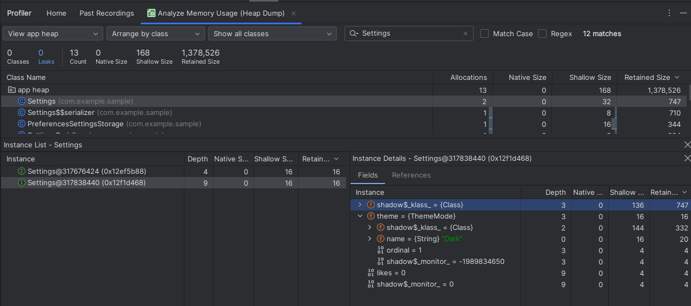
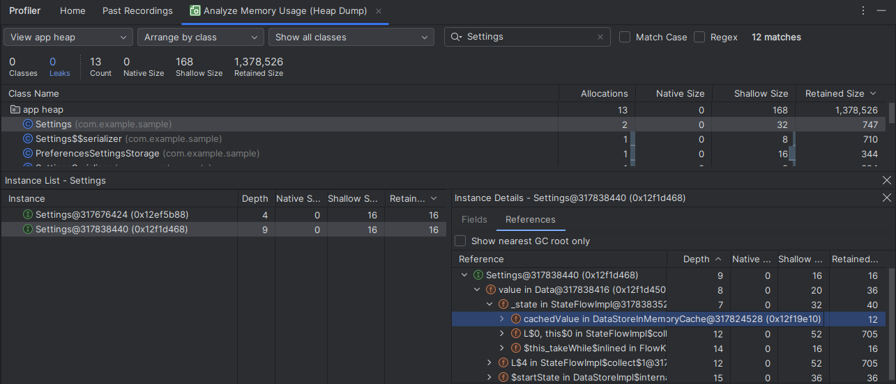
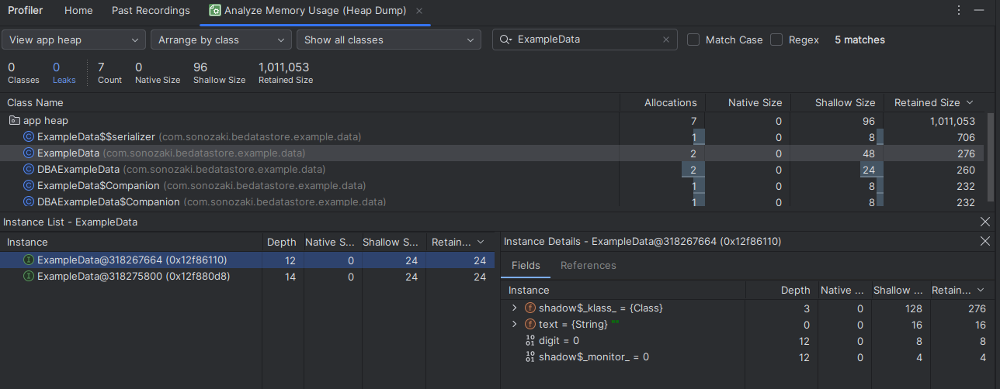
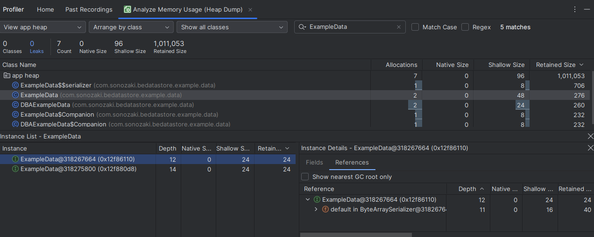
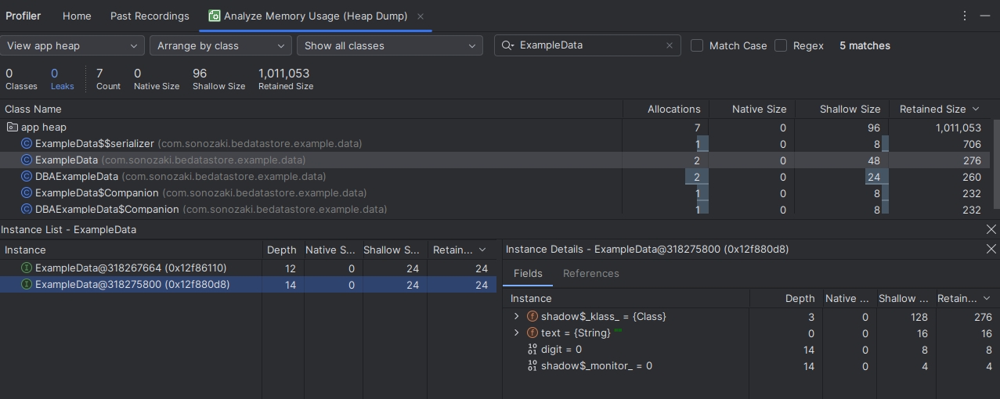
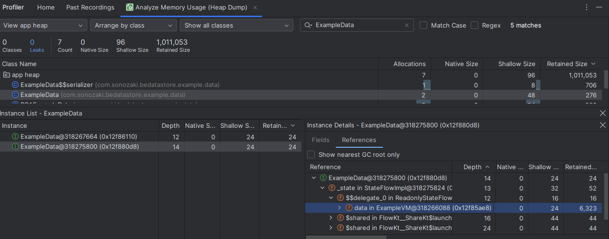

# Better Encrypted Datastore
Better Encrypted Datastore adds encryption and optional device-protected storage to AndroidX DataStore 1.1.3. It exposes the `DataStore<T>` interface and requires Android 8.0 (API 26) or later.

On screenshots below you can see that unencrypted data remains in RAM long time after user put application in background.





Better Encrypted Datastore keeps ciphertext in the file and in the underlying AndroidX DataStore cache. It uses a separate cache to share the decrypted value among active collectors of `data`. When the last collector finishes or is cancelled, the library drops the cache's reference to the decrypted value. An `updateData` call without active collectors uses plaintext during the operation and leaves the decrypted cache empty.

On screenshots below you can see that no references to the actual data remains in RAM when user put app in background and after garbage collector run - only default values. 






## Limitations

Plaintext can appear in memory during reads, writes, and migrations, and the decrypted cache can stay populated as long as a collector is active. Moving the app to the background only releases the cache if collection stops. Once all references to a value are gone, the runtime can reclaim it during garbage collection. The timing is up to the runtime, and residual bytes can remain in process memory even after the object is reclaimed.

The app controls how long it retains values received from DataStore. For example, a ViewModel that uses `stateIn` can use `SharingStarted.WhileSubscribed(replayExpirationMillis = 0)` to reset its `StateFlow` to the initial value as soon as sharing stops. `stopTimeoutMillis` controls how long sharing continues after the last subscriber leaves. Any references held elsewhere in the app have their own lifetime.

## Usage

Android 8.0. is the minimal supported version.


In `settings.gradle.kts`, add JitPack to your dependency repositories alongside Google Maven and Maven Central.

```kotlin
dependencyResolutionManagement {
    repositories {
        google()
        mavenCentral()
        maven { url = uri("https://jitpack.io") }
    }
}
```

Add the dependency to your module's `build.gradle.kts`.

```kotlin
dependencies {
    implementation("com.github.bakad3v:BetterEncryptedDatastore:1.1.3.0")
}
```

Declare the delegate once per file at the top level. The delegates support access from a single process.

```kotlin
private val Context.exampleDatastore by encryptedDataStore(NAME, ExampleSerializer())
```

Use `context.exampleDatastore.data` and `context.exampleDatastore.updateData` as with AndroidX DataStore.

- `alias` defaults to the file name. New writes use AES-GCM with the Android Keystore alias `<alias>.bedatastore-gcm-v1`. Existing files written by the library with AES-CBC can still be read with the original alias and key. An update that changes their value writes the new format, which requires a version of the library that supports AES-GCM.
- `isDBA` defaults to `false`. Set it to `true` to use device-protected storage. To access the store before the first unlock, use an app component declared with `android:directBootAware="true"`. Encrypted reads also require the corresponding Keystore key to be available. [Android Direct Boot guide](https://developer.android.com/privacy-and-security/direct-boot)

Use `dataStoreDBA` for device-protected storage without the library's additional encryption.

```kotlin
private val Context.dbaDatastore by dataStoreDBA(DBA_NAME, DBASerializer())
```

## Examples
This library is used for storing data in my open-source app [Android Antiforensic Tools](https://github.com/bakad3v/Android-AntiForensic-Tools).

## Tests

- `./gradlew :bedatastore:testDebugUnitTest` runs the adapted AndroidX DataStore 1.1.3 contract and migration scenarios, plus tests for cache lifetime and failure handling. The JVM suite uses real files and a test encryption provider.
- `./gradlew :bedatastore:connectedDebugAndroidTest` runs the Android Keystore and process recovery tests on a connected device or emulator.
- `./gradlew :bedatastore:connectedDebugAndroidTest -Pandroid.testInstrumentationRunnerArguments.class=com.sonozaki.bedatastore.recovery.DataStoreProcessRecoveryTest` runs only the process recovery tests. They kill a worker in the test APK during reading, writing, or migration and verify the encrypted file from a fresh store while the device stays on. The JVM tests model storage faults separately with partial reads, failed writes, and truncated ciphertext.

The adapted test files identify their upstream sources and retain the [AndroidX license](bedatastore/src/test/ANDROIDX-LICENSE).

CI runs after a pull request is merged into `master`. To run it manually, open **Actions**, select **CI**, and choose **Run workflow**. CI runs JVM tests, release lint, the Maven publication build, and instrumentation tests on API 26 and 35 emulators. The workflow run includes the Maven package and test reports.

After the checks pass on a merge into `master`, CI tags the tested commit with the Maven publication version and requests the JitPack build. For a manual release, select `master` and enable **publish** when starting CI. JitPack builds the Maven package from the tag using `jitpack.yml`.

Set a new publication version in `bedatastore/build.gradle.kts` before merging the next release. If that version already has a tag on another commit, CI leaves it in place. If the JitPack request fails after tagging, rerun the original workflow to retry the same version.

### Performance benchmarks

Run on a physical Android device with `./gradlew :benchmark:connectedReleaseAndroidTest`.
The suite compares `DataStoreBenchmark` (the public encrypted delegate with Android Keystore)
with `AndroidXDataStoreBenchmark` (stock AndroidX DataStore with `OkioStorage`). Both use the same
serializer, payloads, storage directory, and coroutine dispatcher. Each scenario runs with
payloads of 64 B, 4 KiB, 64 KiB, and 1 MiB:

- `coldRead` measures `data.first()` on a fresh DataStore instance with an existing file. The OS file cache is left in place.
- `warmReadWithoutCollectors` measures one-shot reads after priming the AndroidX cache. That cache holds ciphertext for the encrypted delegate and the decoded value for stock AndroidX.
- `hotReadWithCollector` measures one-shot reads with a separate active collector. For the encrypted delegate, the collector keeps the decrypted value cached.
- `updateAndCommit` alternates between two equal-size values and measures `updateData` through the file commit, with no active collectors.

File seeding, payload generation, store setup and shutdown, and result checks run outside the
timed section. The JSON report in `benchmark/build/outputs/connected_android_test_additional_output/`
includes timing samples and device details. Compare results on the same device and build type.
To run only stock AndroidX, add
`-Pandroid.testInstrumentationRunnerArguments.class=com.sonozaki.bedatastore.benchmark.AndroidXDataStoreBenchmark`.

## Donate
You can support me using crypto.

XMR: 88Z5fsVK6FP4oVNjo2BrHydAEa5Y1gTPi5d7BN68sjVDZ9dTn8wPb89WmUxrxf3T37bRGSR5dekkU9aQ7j8ErWcBJ2GZojC

LTC: ltc1qtfhun6yzt0qlpa9d6s8gr2yd70sg0kx755u3se

BTC: bc1qn9a9eyy2vgrz8yvhk0654d63dt56pxhpn6q4xl

USDT (TRC20), TRON: TUCrXnNRXgMccuvGF5cCrNuNJTg4uDvBbZ
